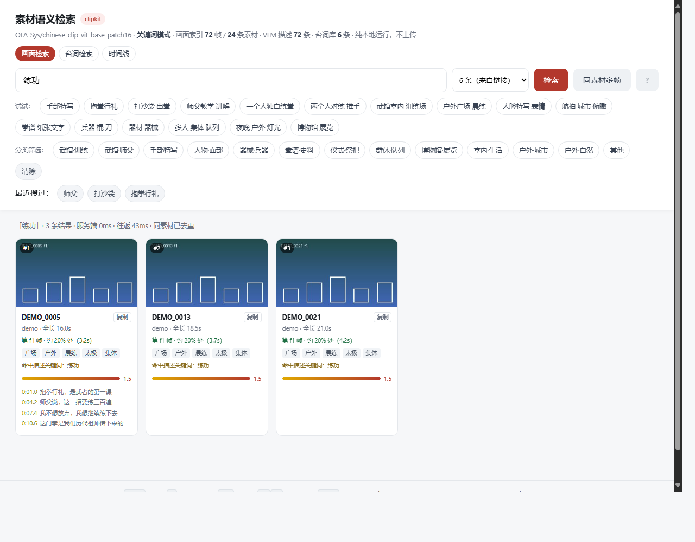

# clipkit · 素材语义检索

> 把一目录视频素材变成「说人话就能找到画面和台词」的本地检索服务。
> 输入中文描述 → 找到对应画面帧、所属素材、大致时间点。全程本地，不上传素材。




## 它解决什么问题

剪辑时人记住的是**内容**（"那个抱拳行礼的镜头"），但硬盘上只有文件名（`DSC_6267.MOV`）。
clipkit 建立「内容 → 素材 + 时间点」的映射：

| 能力 | 说明 |
|---|---|
| **画面语义检索** | 中文描述 → 最像的画面帧 + 素材名 + 时间码 |
| **VLM 描述混合排序** | 视觉相似度 + 画面描述关键词加权，并给出**命中理由** |
| **台词检索** | 关键词优先，无命中时用语义兜底 |
| **时间线视图** | 画面帧与台词按时间码合并，看清"第几秒是什么画面、谁在说话" |
| **分类筛选** | 从 VLM 的景别 / 器械等结构化字段推导类别 |

### 排序为什么可信

每条结果都给出**命中理由**，不是黑箱分数：

```
「出拳」· 6 条结果
#1  DSC_6260  f2  约 50% 处 (4.7s)   0.5173
    武术 · 健身房 · 出拳 · 挡住 · 打沙袋
    命中描述关键词：出拳        <-- 排序依据可核对
```

## 30 秒试一下（不需要素材、不需要 GPU、不需要联网）

```bash
git clone https://github.com/<you>/clip-search-kit.git
cd clip-search-kit

python -m clipkit demo my-demo     # 造一份合成数据
cd my-demo
python -m clipkit serve            # 打开 http://127.0.0.1:8777
```

想确认这套东西在你机器上确实能跑：

```bash
python selftest.py                 # 35 项检查，约 30 秒，零第三方依赖
```

## 用在自己的素材上

```bash
# 0) 装一次（可选；装完在任何目录都能用 python -m clipkit）
pip install --user --no-deps .

# 1) 初始化：指向你的素材目录（可以有多个）
python -m clipkit init --media "/path/to/footage"

# 2) 体检：告诉你缺什么、现在能做到什么
python -m clipkit doctor

# 3) 流水线（缺哪步补哪步，每步都能单独重跑）
python -m clipkit scan         # 扫描素材，读时长 / 分辨率
python -m clipkit frames       # 按 20%/50%/80% 抽帧
python -m clipkit index        # 建 CLIP 向量索引
python -m clipkit tag          # 用视觉大模型给每帧写中文描述
python -m clipkit transcribe   # 本地转写台词

# 4) 用
python -m clipkit serve                       # 网页检索
python -m clipkit query "抱拳行礼"             # 命令行检索
python -m clipkit query "师父" --subs          # 搜台词
python -m clipkit query "抱拳" --json          # 给程序 / AI 解析
```

## 依赖：缺了会降级，不会崩

| 依赖 | 必需？ | 缺了会怎样 |
|---|---|---|
| Python ≥ 3.9 | **必需** | 跑不起来 |
| numpy | 建议 | 退化为纯关键词检索（功能完整） |
| pillow | 建议 | `demo` 不生成占位图，其余不受影响 |
| ffmpeg | 建议 | 没法抽帧 / 抽音轨 |
| torch + transformers | 可选 | 没有画面语义检索，只有关键词 |
| faster-whisper | 可选 | 没有台词检索 |
| tkinter | 可选 | 图形面板降级为控制台菜单 |

**实测**：在没有 numpy、没有 pillow 的裸 Python 上，`demo` / `query` / `serve` / 时间线 / 台词检索全部可用。

`doctor` 会逐项如实报告当前能力边界，**不会假装能干活**。

## 三种界面（自动降级）

| 方式 | 条件 |
|---|---|
| 图形面板 | 当前 Python 有 tkinter（`python 启动器.py`） |
| 控制台菜单 | 没有 tkinter 时自动切换（功能一样） |
| Web 面板 | 任何情况（`python -m clipkit serve`） |

## 作为「技能」给 AI Agent 用

仓库本身就是一份可复用的 skill：

- `SKILL.md` —— 通用 YAML frontmatter 技能描述，WorkBuddy / SkillHub / Claude Skills 等同规范平台可直接识别
- `INSTRUCTIONS.md` —— 给「不认识 skill 规范」的 agent 看的接入说明书（含 `--json` 输出格式）
- `PORTABILITY.md` —— 各平台放置位置、依赖矩阵、迁移注意事项

判断标准：**只要目标 agent 能读文件 + 能执行 shell，就能用**，不需要 SDK 或插件。

## 已知边界（重要）

- **这是模糊排序，不是精确匹配。** 结果必须人工核对，不要把排序当结论。
- **时间码是粗定位。** 每条素材默认只抽 3 帧（20%/50%/80%），「命中 f2 帧」≈ 50% 处，不是精确帧号。
  要精确就加密 `frame_fracs`。
- **纯英文查询效果一般**，因为用的是中文 CLIP，建议用中文。
- `tag` 步骤需要视觉大模型 API Key（支持智谱 / Kimi / 火山方舟），没有就跳过，不影响画面检索本身。

## 项目结构

```
clipkit/
  __main__.py   CLI 入口与参数
  commands.py   各命令实现（init/doctor/scan/frames/index/tag/transcribe/serve/query/demo）
  store.py      数据层：索引 / VLM 描述 / 台词 的加载与分类（只依赖标准库）
  search.py     检索引擎：向量可用时混合排序，否则纯关键词降级
  web.py        HTTP 服务（只用标准库 http.server，无 Flask）
  wordvec.py    无模型时的词表语义兜底（demo 用）
templates/      界面资源（改完重启即可）
selftest.py     零依赖自测：35 项，用合成数据验证整条链路
启动器.py / gui.py / start.sh / 启动.bat   三种启动方式
```

## 数据格式（便于与其它工具对接）

| 文件 | 内容 |
|---|---|
| `clipkit.json` | 配置：素材目录、抽帧比例、模型、端口 |
| `.clipkit/index/index.csv` | 每帧：img, clip, frame, at, approx_sec, group, dur |
| `.clipkit/index/vectors.npy` | 帧向量，与 index.csv 行序一一对应 |
| `.clipkit/tags/tags.jsonl` | 每帧 VLM 描述 |
| `.clipkit/transcripts/transcripts.jsonl` | 每条素材台词（含时间轴） |

## 开发

```bash
python selftest.py       # 全量自测（零第三方依赖，可在 CI 跑）
python -m clipkit --help # 看所有命令
```

## 许可

MIT
